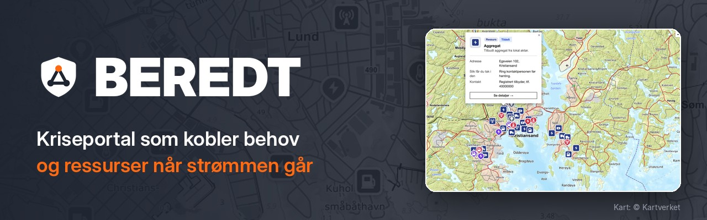
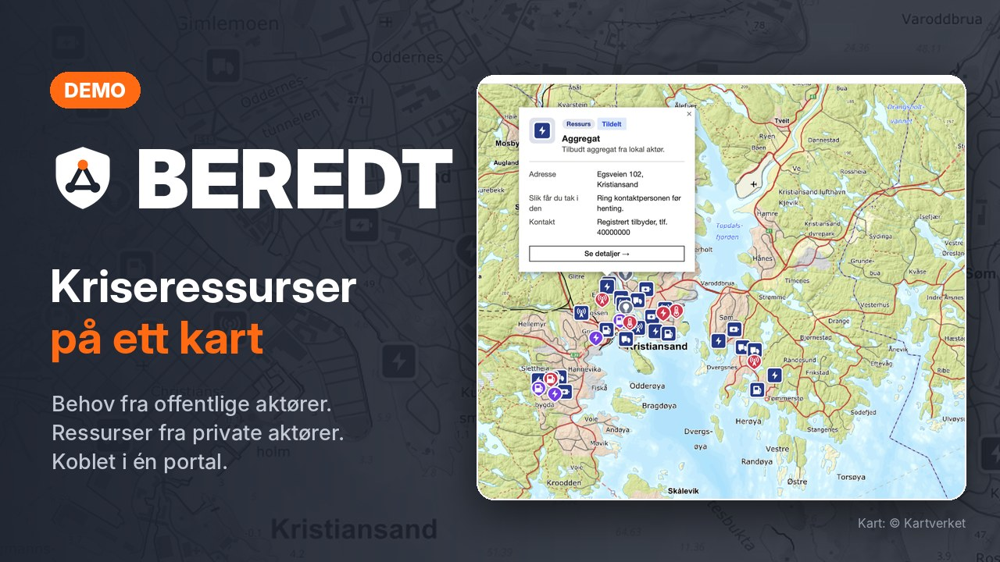
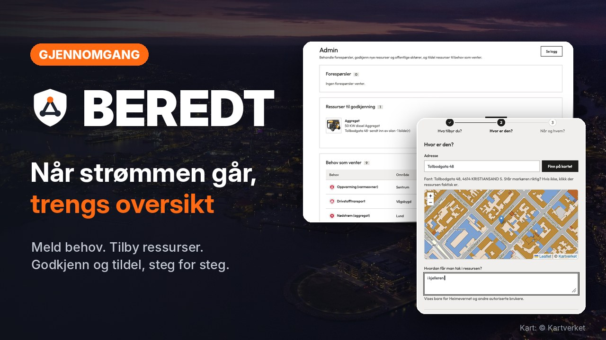
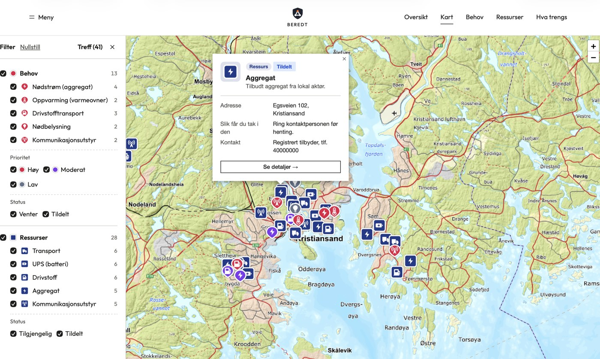
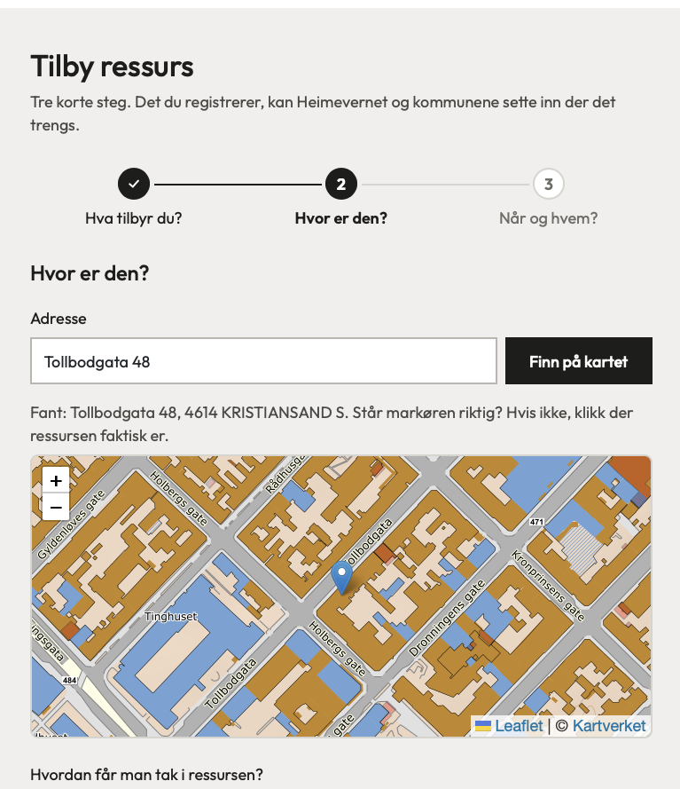
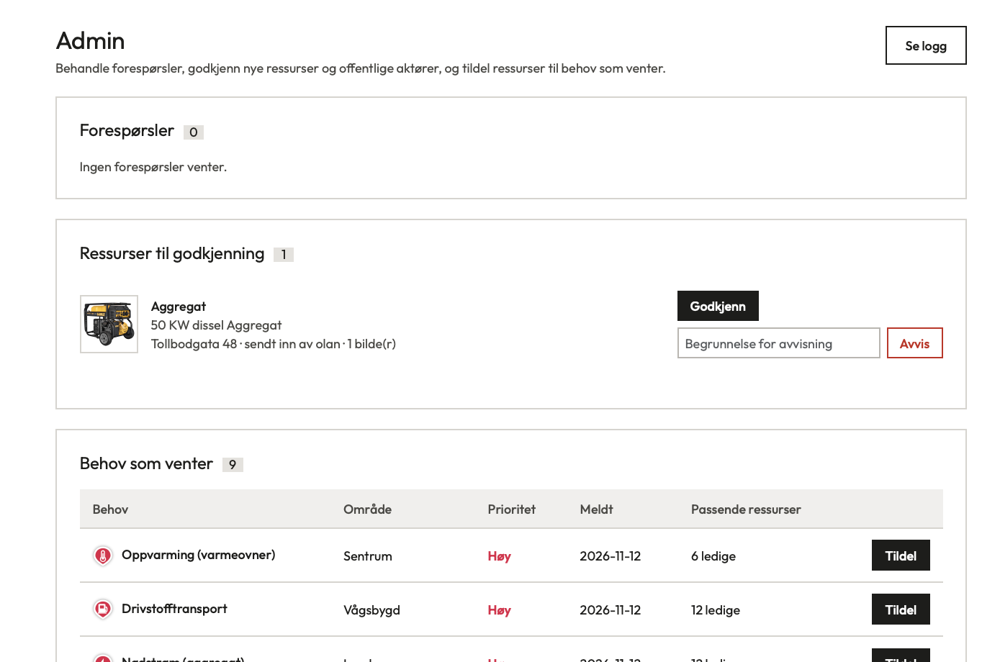
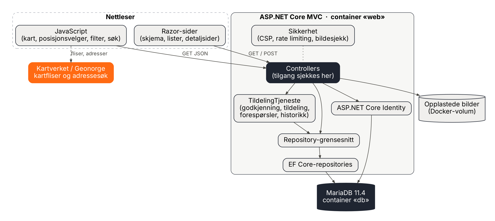

<div align="center">



<br>


**Beredt kobler behov fra offentlige aktører med ressurser fra bedrifter og privatpersoner under en krise, og viser alt på ett kart.**

[Se demo](#se-beredt-i-bruk) · [Kom i gang](#kom-i-gang) · [Arkitektur](#arkitektur) · [Dokumentasjon](#dokumentasjon)

</div>

---

## Se Beredt i bruk

<table>
  <tr>
    <td width="50%" align="center">
      <a href="https://youtu.be/oDRM7-IV-T8"></a>
      <br><b>Demo</b> – kort presentasjon av portalen
    </td>
    <td width="50%" align="center">
      <a href="https://youtu.be/SQKd4gYPiag"></a>
      <br><b>Gjennomgang</b> – alle rollene, steg for steg
    </td>
  </tr>
</table>

## Hva er Beredt?

Et cyberangrep slår ut strømnettet i Kristiansand. Kommunen, sykehuset og Heimevernet trenger raskt aggregater, drivstoff og transport, men mye av det finnes hos bedrifter og privatpersoner. Hvem har hva, og hvor?

I Beredt melder **offentlige aktører** inn behov, og **private aktører** tilbyr ressurser. En **administrator** godkjenner og tildeler ressursene, med forslag sortert på type og avstand. Alt vises på et kart med data fra Kartverket.

Portalen er laget av Gruppe 19 ved Universitetet i Agder, med en case fra Kartverket og Heimevernet.

## Slik fungerer det

| Offentlig aktør | Privat aktør | Administrator |
|---|---|---|
| Melder behov med type, prioritet og plassering | Tilbyr ressurser i tre steg, med bilder og kartpunkt | Godkjenner nye ressurser og offentlige aktører |
| Ser behov og godkjente ressurser på kart og i lister | Følger status på egne ressurser | Tildeler ressurser til behov, med forslag etter type og avstand |
| Finner og ber om en ressurs til eget behov | Ser hva som trengs, uten å se hvem som meldte det | Behandler forespørsler og følger alt i adminloggen |

## Skjermbilder

<p align="center">
  
  <br><sub>Kartet: behov farget etter prioritet, ressurser som firkanter, og detaljer i boblen.</sub>
</p>

<table>
  <tr>
    <td width="50%"><br><sub>Tilby ressurs: plassering med adressesøk eller klikk i kartet.</sub></td>
    <td width="50%"><br><sub>Adminsiden: køer for forespørsler, ressurser og behov.</sub></td>
  </tr>
</table>

## Funksjoner

- **Kart** med Leaflet og kartfliser fra Kartverket, egne ikoner per type og farge per prioritet
- **Tildeling med forslag:** ledige ressurser av passende type, sortert etter avstand
- **Forespørsler:** offentlige aktører kan be om en bestemt ressurs, og admin godkjenner
- **Historikk og adminlogg:** alt som skjer med et behov eller en ressurs blir lagret, med hvem og når
- **Søk og filter** i alle lister
- **Personvern:** adresse, tilgangsbeskrivelse og bilder vises bare for godkjente offentlige aktører
- **Tilpasset mobil** og laptop

## Teknologi

| Område | Teknologi |
|---|---|
| Rammeverk | ASP.NET Core MVC, .NET 10 |
| Innlogging | ASP.NET Core Identity (passord-hash med PBKDF2, roller, utestenging) |
| Database | MariaDB 11.4 med Entity Framework Core og migrations |
| Kart | [Leaflet](https://leafletjs.com/) med kartfliser og adressesøk fra Kartverket |
| Testing | xUnit og NSubstitute |
| Drift | Docker Compose (to containere: `web` og `db`) |

## Arkitektur

<p align="center"></p>

Controllerne kjenner bare repository-grensesnittene. Da databasen ble byttet fra minnet til MariaDB, var `Program.cs` den eneste filen som måtte endres. Reglene for godkjenning, tildeling og historikk ligger samlet i `TildelingTjeneste`, så de er like uansett hvilken side de brukes fra.

Full beskrivelse: **[docs/arkitektur.md](docs/arkitektur.md)**

## Kom i gang

**Krever:** [Docker Desktop](https://www.docker.com/products/docker-desktop/)

```bash
git clone https://github.com/thilomoi05/Prosjekt_host_1.git
cd Prosjekt_host_1
cp .env.example .env      # Windows (PowerShell): copy .env.example .env
docker compose up --build
```

Åpne **http://localhost:8080** og logg inn med en av testbrukerne:

| Brukernavn | Passord | Rolle |
|---|---|---|
| `test` | `Beredt2026` | Offentlig aktør |
| `privat` | `Beredt2026` | Privat aktør |
| `admin` | `Beredt2026` | Administrator |

Testbrukerne er bare for lokal kjøring. Mer om oppsett, porter og feilsøking: **[docs/drift.md](docs/drift.md)**

## Testing og kvalitet

- **162 automatiske tester** (xUnit og NSubstitute) som kjøres uten database: `dotnet test Beredskapsportal.Tests`
- **Sikkerhetstest** mot vanlige angrep (OWASP): tilgangskontroll, CSRF, XSS, SQL-injeksjon, falske bilder, rate limiting
- **System-, mobil- og brukertester**, med resultater og funn
- **Alle endringer via pull request** med kodegjennomgang

Detaljerte testresultater: **[docs/testing.md](docs/testing.md)**

## KI i utviklingen

Vi brukte Claude Code som kodeassistent, med egne regler for agenten i [AGENT.md](AGENT.md). Agenten committer aldri rett til main, og alle endringer går gjennom pull request og kodegjennomgang. Hvordan vi brukte KI, med eksempler på prompter: **[docs/ki-bruk.md](docs/ki-bruk.md)**

## Dokumentasjon

| Dokument | Innhold |
|---|---|
| [docs/arkitektur.md](docs/arkitektur.md) | Lagene, innlogging, kartet og alle endepunkter |
| [docs/drift.md](docs/drift.md) | Oppsett, `.env`, testbrukere og feilsøking |
| [docs/testing.md](docs/testing.md) | Automatiske tester, system-, sikkerhets-, mobil- og brukertester |
| [docs/oppgavekrav.md](docs/oppgavekrav.md) | Kravene i Oppgave 1 og 2, endringer etter tilbakemelding, alle endepunkter og kjente begrensninger |
| [docs/ki-bruk.md](docs/ki-bruk.md) | Bruk av KI i prosjektet |

## Teamet

Gruppe 19: **Thilo Moi** · **Tobias K. Lindkvist** · **Christian Urdal Hansen** · **Ludvig Jensen** · **Pelle Kvandal** · **Emil Lund Storebaug**

## Om prosjektet

Laget høsten 2026 i emnene IS-200, IS-201 og IS-202 ved Universitetet i Agder, og vist fram på emnenes EXPO. Casen *Kriseberedskap: ressurs- og behovsportal for Totalforsvaret* er gitt av Kartverket og Heimevernet.

<sub>Kartdata © Kartverket.</sub>
